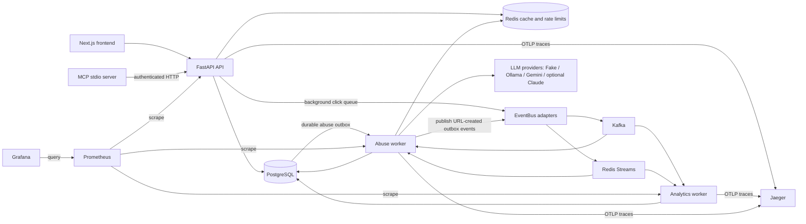

# Distributed URL Shortener

A local-first URL shortener for exploring the engineering behind a small distributed system: FastAPI serves authenticated link management and public redirects, PostgreSQL stores durable records, Redis accelerates reads, and background workers process click analytics and abuse checks. A Next.js frontend and a read-only-by-default MCP server expose the same API. The project includes reproducible tests, observability, performance workloads, and failure experiments; measured evidence and known limitations are documented alongside the code.

[](https://github.com/AndreasPr/Distributed-URL-Shortener/actions/workflows/ci.yml)
[](https://github.com/AndreasPr/Distributed-URL-Shortener/actions/workflows/k8s-smoke.yml)
[](https://github.com/AndreasPr/Distributed-URL-Shortener/actions/workflows/codeql.yml)
[](#license)

**Demo video:** link to be added after recording.

- Redirects use bounded background event publishing, with PostgreSQL fallback when Redis fails.
- Abuse detection combines URL heuristics with optional schema-validated LLM classification, backed by a reproducible evaluation.
- Operational claims are supported by test, benchmark, and chaos records—not inferred from the architecture diagram.

## Architecture



Kafka and Redis Streams are alternative event adapters; the lightweight mode shares Redis with caching. The in-memory adapter is for tests. The default abuse provider is deterministic `fake`; configuring a real provider is an explicit choice.

1. **Shorten:** `POST /shorten` validates an HTTP(S) URL, optional alias and expiry, checks API-key scope and the write token bucket, then persists a collision-safe code and a durable abuse outbox entry. The abuse worker relays it as `url.created` for asynchronous review.
2. **Redirect:** `GET /{code}` checks lifecycle/abuse state and resolves the destination through cache/database paths. Expired links return 410, deleted links 404, and blocked links 451. A successful redirect enqueues a click; the analytics worker writes it later, deduplicating by event ID. Cache hits still involve database checks.
3. **Abuse check:** the worker computes URL features without fetching the destination. Clearly low/high scores use heuristics; gray-zone cases use the configured LLM. Suspicious links enter an authenticated review queue; malicious links are blocked. This is asynchronous, so a new link can redirect before classification completes.

## Quick start

Prerequisites: Docker Desktop/Engine with Compose v2; Node 22.13+ and npm for the frontend. Run commands from the repository root. Python development setup is separate in the [developer guide](docs/developer.md).

Create local configuration only if absent:

```bash
test -f .env || cp .env.example .env
```

Edit `.env`: replace `POSTGRES_USER`, `POSTGRES_PASSWORD`, `POSTGRES_DB`, `GRAFANA_ADMIN_USER`, and `GRAFANA_ADMIN_PASSWORD` placeholders. Use URL-safe database credentials; do not replace credentials for existing volumes. Keep `LLM_PROVIDER=fake` for a credential-free demo. Never commit `.env` or keys.

Choose **one** mode; both bind the same host ports. Existing stacks can block startup
(for example PostgreSQL port 5433); use free ports or stop only your intended old stack. Compose runs Alembic migrations before starting the API/workers.

### Lightweight: Redis Streams

```bash
LLM_PROVIDER=fake make up PROFILE=redis-streams
docker compose --profile redis-streams exec api-redis \
  python -m app.cli keys create --name browser --scopes read write
```

### Full event stack: Kafka

```bash
LLM_PROVIDER=fake make up PROFILE=kafka
docker compose --profile kafka exec api \
  python -m app.cli keys create --name browser --scopes read write
```

Wait for `/health` to return HTTP 200 before creating the key. A successful `make up`
only starts containers; Grafana may need additional startup time before its UI responds. The CLI prints its full value **once**; keep it private. Use it in Swagger's authorization dialog or the frontend's in-memory key field. Keys for admin review require the `admin` scope; create a separate operator key with the same CLI when needed.

To inspect logs or stop a mode, for example:

```bash
make logs PROFILE=redis-streams
make down PROFILE=redis-streams
```

Use `PROFILE=kafka` for the Kafka stack. Stop the active profile before switching. `make down` retains volumes; services using those volumes must keep the same credentials.

### Frontend and local endpoints

The frontend runs on your host, outside Compose and Kubernetes:

```bash
cd frontend
test -f .env.local || cp .env.example .env.local
npm ci
npm run dev
```

`NEXT_PUBLIC_API_URL` defaults to `http://127.0.0.1:8000` in the example. Open the frontend through `http://localhost:3000`, matching default CORS settings. The browser key field does not persist the key in localStorage.

| Component | Local address | Notes |
|---|---|---|
| Frontend | http://localhost:3000 | Requires the separate npm command |
| API / Swagger | http://localhost:8000/docs | Use `X-API-Key` for protected operations |
| Health | http://localhost:8000/health | Dependency readiness; `/livez` is dependency-independent |
| Prometheus | http://localhost:9090 | Metrics and alert rules |
| Grafana | http://localhost:3001 | Credentials from `.env`; provisioned dashboards |
| Jaeger | http://localhost:16686 | Trace search |

Redirects, health and liveness are public. Link creation/deletion require write scope; listing and analytics require read scope; flagged-link review is admin-only. Public redirects and writes are rate-limited. Metrics are exposed locally and restricted to internal access in Kubernetes. See [security](docs/security.md) and [deployment troubleshooting](docs/DEPLOYMENT.md).

## Record a local demo

`make demo` starts an isolated Redis Streams/FakeProvider stack, including the frontend,
runs migrations, seeds 30 links with click history and six flagged fixtures, and prints
fresh private keys once. Requires Docker Compose >=2.24.4 and Python 3.9+; no host Node/.venv
or cloud credentials. Demo ports differ from the ordinary stack above. Follow the
[three-minute script](docs/demo-script.md); `make demo-down` removes demo data and credentials.

## Development and verification commands

Run these from the repository root after following the [developer setup](docs/developer.md). Specialized checks have additional local tool prerequisites documented in their guides.

| Command | Purpose |
|---|---|
| `make check` | Backend lint, types, unit tests and Prometheus rules |
| `make fmt` | Apply backend formatting |
| `make frontend-check` | npm ci, ESLint, frontend tests and TypeScript |
| `make mcp-test` | MCP lint, types and tests |
| `make test-integration` | Unit + PostgreSQL/Redis Testcontainers tests and combined coverage floor; Docker required |
| `make test-integration-slow` | Also include optional Kafka integration tests |
| `make audit` | Python dependency vulnerability audit |
| `make eval EVAL_PROVIDER=fake` | Offline synthetic abuse evaluation; overwrites the generated evaluation report |
| `make perf` | Disposable performance stack; saves summaries under ignored `perf/results/` |
| `make chaos` | Intentionally disrupt an existing local test stack; configure key/backend first |
| `make tf-fmt` | Terraform format check |
| `make tf-validate` | Initialize without backend, then validate; downloads providers but needs no AWS credentials |
| `make tf-lint` | TFLint checks |
| `make tf-sec` | Checkov checks with documented exceptions |
| `bash scripts/kind_smoke.sh` | Disposable kind deployment and smoke gate |
| `.venv/bin/python scripts/check_readme.py` | Offline README link and command checks |

The [CI guide](docs/ci-cd.md) describes blocking checks, image scanning/publishing, CodeQL and the kind smoke workflow. The [Kubernetes guide](docs/kubernetes.md) covers overlays, migrations, probes and manual deployment. The CI overlay uses Redis Streams; the local overlay uses Kafka.

## Results and evidence

See the [CV claim evidence](docs/claims.md), [final audit](docs/final-audit.md), and
[known limitations](docs/known-limitations.md), including outstanding frontend security findings.

- [Performance](docs/performance.md): workload method, hardware fields, capacity arithmetic and benchmark table. Capacity estimates are assumptions, not measured limits; unfilled measurements remain TBD.
- [Chaos](docs/chaos.md): recorded Compose and kind worker experiments, including failed broker accounting before the retry fix and successful runs afterward. Kafka chaos remains unverified.
- [Abuse evaluation](docs/eval-results.md): saved evaluation results and provider limitations. Synthetic FakeProvider results are regression evidence, not real-world model accuracy.
- [Testing](docs/testing.md): unit/integration boundaries, coverage policy and Docker requirements.

Retain failed runs and disclose environment, sample size and provider errors. A successful benchmark does not prove unlimited capacity, and a passing chaos run does not establish every failure mode.

## Design decisions and trade-offs

- [Random short codes](docs/adr/0001-short-code-generation.md): database uniqueness plus bounded retries avoids replica coordination; randomness is not access control.
- [Cache strategy](docs/adr/0002-cache-strategy.md): single-flight, short locks, negative caching and a breaker reduce load, while lifecycle checks preserve deletion/block semantics.
- [Event adapters](docs/adr/0003-event-bus.md) and [publish retries](docs/adr/0022-retry-ambiguous-click-publications.md): stable event IDs allow idempotent analytics; the bounded in-memory publisher is not a durable outbox.
- [Abuse pipeline](docs/adr/0004-abuse-pipeline.md): no destination fetching; heuristic gating reduces LLM calls but cannot guarantee phishing detection.
- [MCP boundary](docs/adr/0014-mcp-http-boundary.md): typed on-demand tools call the API, default to read-only, and audit calls; no direct database access or continuous monitoring.
- [AWS design](docs/adr/0019-validation-only-aws-design.md): modular Terraform demonstrates a deployment design without creating paid infrastructure.

## Deliberately out of scope

- Multi-region operation: the running system is local/single-region in scope.
- Proven multi-AZ failover: local/kind storage is not an AWS availability-zone deployment. Terraform models redundancy, but failover has not been deployed or tested.
- AWS production deployment: Terraform was **validated, not deployed**; NAT, RDS, ElastiCache, ALB and other resources would cost money if applied. No automatic apply workflow exists.
- Guaranteed lossless click publication across API crashes or prolonged broker outages: bounded queues/retries can abandon events, and timed-out acknowledgements can be ambiguous.
- Guaranteed malicious-link prevention, destination crawling, and autonomous LLM tools. Real provider use requires checking current availability, privacy and quotas.
- A hosted frontend, global CDN, tenant billing, and a fully managed production operations service.

## Documentation index

| Area | Guides |
|---|---|
| Local development | [Developer setup](docs/developer.md), [deployment](docs/DEPLOYMENT.md), [API changes](docs/api-changes.md) |
| Data and safety | [Migrations](docs/migrations.md), [security](docs/security.md), [threat model](docs/threat-model.md) |
| LLM and abuse | [Providers](docs/llm.md), [pipeline](docs/abuse-pipeline.md), [evaluation runner](eval/abuse/README.md) |
| MCP clients | [Setup, tools and demo prompts](docs/mcp.md) |
| Observability | [Traces and logs](docs/observability.md), [Grafana](docs/GRAFANA.md), [SLOs](docs/slo.md), [runbook](docs/runbook.md) |
| Delivery | [CI/CD](docs/ci-cd.md), [Kubernetes](docs/kubernetes.md), [AWS architecture](docs/aws-design.md), [Terraform setup/costs](infra/terraform/envs/dev/README.md) |
| Evidence and decisions | [Engineering design](docs/design.md), [Baseline](docs/baseline.md), [ADRs](docs/adr/), [performance](docs/performance.md), [chaos](docs/chaos.md) |

## License

No repository license file is currently provided. The badge states this explicitly; it does not grant an open-source license. Dependency licenses are separate.
