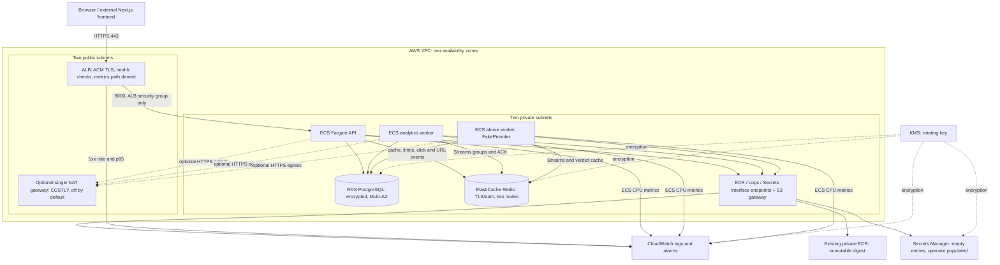

# AWS architecture design (validated, never deployed)

This is a Terraform design artifact for the existing application. No AWS resource
has been created, no credentials were supplied, and no plan/apply was run. Validation
cannot establish cloud runtime correctness. See [dev prerequisites and cost warning](../infra/terraform/envs/dev/README.md)
and [actual verification](terraform-verification.md).

## Mapping to the local system

| Local component | AWS design | Trade-off / missing integration |
| --- | --- | --- |
| API container / kind Deployment | Fargate task/service and ALB | No server administration; per-task billing and private image/secret bootstrap required |
| Analytics and abuse workers | Separate Fargate services using the same digest | Independent CPU scaling; queue-lag-based scaling is not implemented |
| PostgreSQL container + Alembic Job | Private encrypted Multi-AZ RDS + manually invoked migration task | Managed backups/failover; privileges, CA bundle, quotas and migrations need operator validation |
| Redis cache, token buckets and Streams | TLS/auth ElastiCache replication group | Compatible Redis commands; asynchronous replication can lose recent events on failover; cache/stream memory contention remains |
| Kafka or Redis Streams | **Implemented design: Redis Streams**; alternatives SQS or MSK | SQS needs a new EventBus adapter and visibility/DLQ semantics; MSK needs authenticated/TLS Kafka configuration and capacity/network review. Neither is provisioned or a drop-in configuration change |
| Prometheus rules / Grafana dashboards | CloudWatch ALB/ECS metrics, alarms and logs | Existing PromQL/dashboard JSON are not automatically converted; cache-hit SLO and analytics freshness require custom metric export |
| Optional managed dashboards | Amazon Managed Grafana / Managed Prometheus alternatives | Additional paid services and IAM/data-source work; not included |
| Jaeger / OTLP | Future ADOT collector and X-Ray or another reviewed OTLP backend | No collector or trace backend is deployed. The current app explicitly creates an OTLP exporter; setting `OTEL_SDK_DISABLED` alone is not a verified disable mechanism. Configure a collector or an explicit application tracing switch before cloud production use |
| Next.js and MCP client | Outside this stack | Hosting/DNS are not provisioned. CORS is explicit; MCP still uses the authenticated HTTP API |
| Local LLM fake mode | `LLM_PROVIDER=fake` | No live provider call, key or spend; this is not evidence of production abuse-classification accuracy |

## Security, lifecycle and availability decisions

The network module creates two public and two private subnets, distinct routing,
locked default security group, scoped ingress/egress and VPC flow logs. Data stores
and tasks have no public IPs. Public traffic reaches only HTTPS; ALB cannot publicly
serve `/metrics`. Only ALB subnet CIDRs are trusted as proxy peers, with security-group
rules allowing API ingress only from the ALB. Container `/livez` checks do not depend
on data services; ALB `/health` checks readiness. A Redis outage may therefore remove
API targets even though the application can fall back to PostgreSQL for redirects;
ALB's all-unhealthy behavior and this readiness choice need live failure testing.

Fargate uses non-root UID 10001, read-only root filesystems and dropped capabilities.
Images use an immutable digest; the managed Fargate platform uses `LATEST` to receive
AWS runtime security maintenance. API and workers use graceful 120-second stops and
deployment circuit breakers. When explicitly enabled, CPU target tracking scales
from two to four tasks; CPU is a rough proxy for worker queue pressure.

Execution roles can pull only one ECR repository, write only project log streams,
read only two application secrets and decrypt only their KMS key through Secrets
Manager. ECR authorization-token retrieval necessarily uses resource `*`; the image
read statements remain scoped. The application task role has **no AWS API policy**.
RDS's AWS-managed master password is not granted to the application. Secret entries
have no Terraform-managed values; Redis provisioning's sensitive token is still
present in state, which must be protected separately.

Services default to zero until secrets and schema are ready; the default deployment
precondition is false. There is no migration provisioner and no cloud apply workflow.
The two-AZ database/cache and minimum-two task design favors resilience over minimal
cost. A single NAT reduces NAT count but still costs money and is an AZ-level failure
point. Interface endpoints also cost money; they permit private AWS access without
NAT but do not provide arbitrary Internet egress (including external LLM APIs).

CloudWatch's 5xx alarm uses target and ALB errors divided by routed requests plus
ALB-generated failures, so an all-ALB-error interval is not silently treated as zero.
It is a whole-ALB approximation, not the redirect-only 30-day SLO. Latency alarms use
p95 TargetResponseTime >500ms; CPU alarms use >80%. Empty SNS action lists mean
alarms change state but **send no notification**. Route-specific SLOs, event freshness,
DLQ and circuit-breaker metrics require further instrumentation/export work.

## Checkov exceptions (resource-local, no global bypass)

| Rule | Resource | Reason and prerequisite before production |
| --- | --- | --- |
| CKV_AWS_91 | ALB | S3 access-log storage omitted for dev cost; enable a reviewed encrypted log bucket and retention before production |
| CKV2_AWS_28 / CKV2_AWS_76 | ALB | Paid WAF ACL/rules omitted; app validation/rate limits are not an equivalent replacement. Review managed rules before exposing production traffic |
| CKV_AWS_118 | RDS | Enhanced Monitoring cost omitted; standard RDS metrics and DB logs remain available |
| CKV2_AWS_57 | Two empty secret entries | No secret version/rotation implementation is managed here; add application-specific rotation before production |
| CKV2_AWS_5 | Application SG | Scanner cannot follow the for_each module attachment; `tests/test_terraform_design.py` checks root → module → service SG wiring |

No IAM wildcard or encryption rule is suppressed. Database backups, snapshot tags,
TLS, storage encryption, KMS rotation, log retention and deletion protection remain
configured. These exceptions and untested AWS integrations mean “validated” does
not mean production-ready. Provider schemas and rules are pinned; future updates
must be reviewed and rerun rather than hidden by new blanket skips.

Reference contracts: [AWS provider resources](https://registry.terraform.io/providers/hashicorp/aws/6.70.0/docs),
[ElastiCache auth and TLS](https://registry.terraform.io/providers/hashicorp/aws/latest/docs/resources/elasticache_replication_group),
and [Checkov resource-local skips](https://www.checkov.io/2.Basics/Suppressing%20and%20Skipping%20Policies.html).
